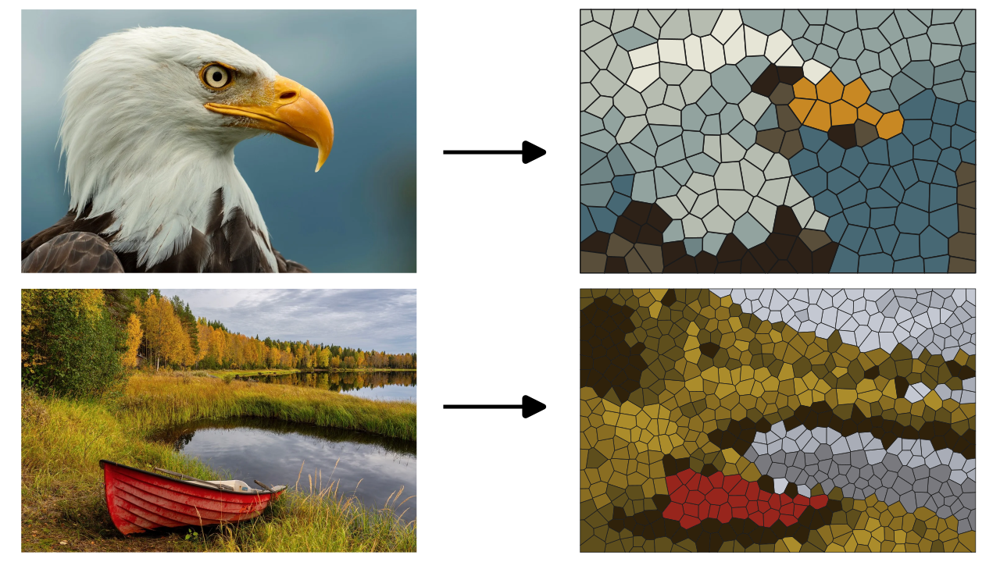
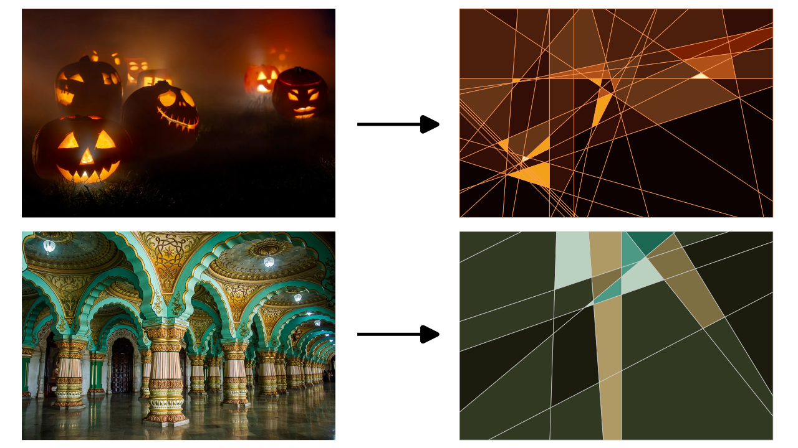
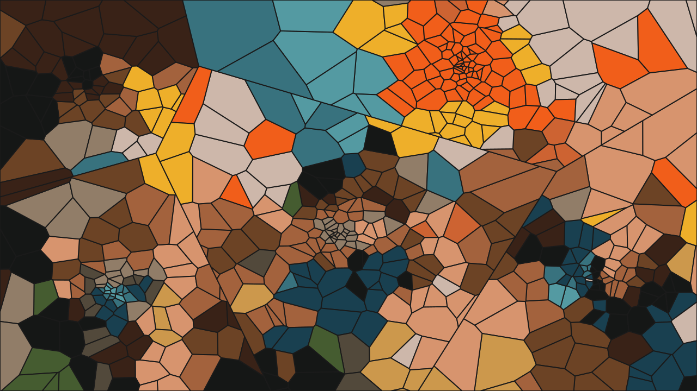
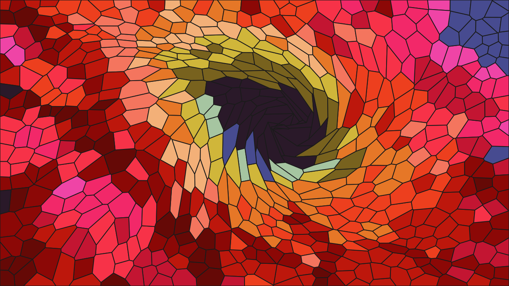
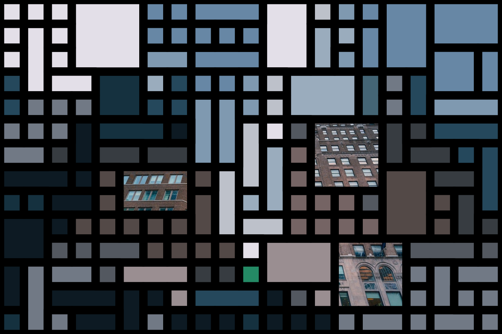
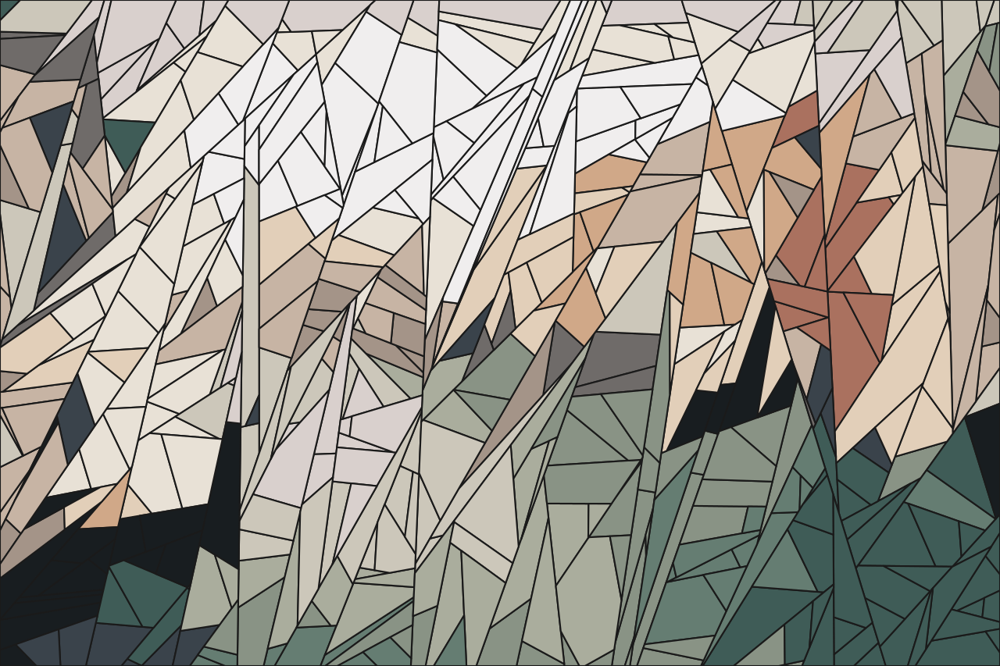

# Inkscape Vector Stained Glass

Turn a photo into a handmade stained-glass window: pick an image, choose
how it gets cut — organic shards, sharp triangles, knife slashes,
city-grid tiles, blooming petals, or river swirls — and watch it break
into panes of color outlined in dark lead, each tinted from the original
so the whole composition stays intact. Pure vector, infinitely scalable,
fully editable.

**Slash Dimension (knife cut)**

**Flowers (larger number of seeds for better detail)**

**River (Swirls)**

**Metro (rectangular tiling, delete some cells to open some windows on it)**

**Splinters**

## Features

- Varies cell shapes:
  - `voronoi` — organic polygonal cells from Poisson-disk / edge-weighted / brightness-weighted seeds
  - `triangles` — Delaunay-based triangular cells with snapped boundary points
  - `quads` — Delaunay triangulation followed by pairing adjacent triangles into
  quads
  - `knife_cut` — "Slash Dimension" style sparse perpendicular-bisector cuts between nearest same-color region centroids
  - `metro` — Metro-style rectangular tiles on an integer grid; tile sizes are modulated by image score (edges / brightness), filled greedily by area and hole-filled to cover the canvas
  - `flowers` — two-level radial Voronoi: first partition the image into
  several large regions, then place ring-shaped "petal" seeds
  inside each region (radius grows quadratically outward with angular
  jitter) and re-run Voronoi to get flower-like radial cells.
  - `splinters` — sequential "wood splinter" cut: seeds are generated
  (Poisson-disk or bias-weighted), then processed one by one; each seed
  splits the polygon that currently contains it with a random-angle line
  passing through the seed, keeping both halves. Later seeds land in
  smaller shards, producing thin, angular splinter-like panes.
- Optional seed biasing:
  - `none` — uniform Poisson-disk sampling
  - `edges` — seeds concentrated on strong image edges
  - `brightness` — seeds biased toward darker areas; also boosts dark regions during cell selection
  - `saliency` — seeds concentrated on visually salient regions (high-contrast /
    attention-grabbing areas)

## Requirements

- Inkscape 1.x

## Install

1. Copy folder into your Inkscape extensions directory:
   - Linux: `~/.config/inkscape/extensions/`
   - macOS: `~/Library/Application Support/org.inkscape.Inkscape/config/inkscape/extensions/`
   - Windows: `%APPDATA%\inkscape\extensions\`
2. Restart Inkscape.

## Usage

Copy the folder of this extension into your Inkscape extensions directory:

- **Linux:** `~/.config/inkscape/extensions/`
- **Windows:** `%APPDATA%\inkscape\extensions\`
- **macOS:** `~/Library/Application Support/org.inkscape.Inkscape/config/inkscape/extensions/`

Restart Inkscape. Requires Inkscape 1.x (Python 3 + `inkex`).

Open **Extensions → Render → Vector Stained Glass**.

## Options

| Option         | Type   | Default   | Description                                                                                     |
| -------------- | ------ | --------- | ----------------------------------------------------------------------------------------------- |
| `cell_shape`   | choice | `voronoi` | see `Features` above |
| `n_colors`     | int    | `12`      | Palette size for color quantization (4–32).                                                     |
| `n_seeds`      | int    | `600`     | Number of cells (seeds / target triangles). Capped internally at `w*h/100`.                      |
| `stroke_width` | float  | `2.0`     | Outline stroke width between cells (0.5–10).                                                    |
| `bias_type`    | choice | `none`    | Seed biasing: `none` (uniform), `edges` (edge-aware), `brightness` (sparser in brighter areas).       |
| `random_seed`  | int    | `42`      | RNG seed for reproducible results.                                                              |
| `blur_size`    | int    | `0`       | Median pre-processing blur size in pixels (0 disables). Forced to odd values.                   |
| `max_dim`      | int    | `300`     | Max dimension (px) of the downscaled copy used for processing (16–1080).                        |

## License

MIT