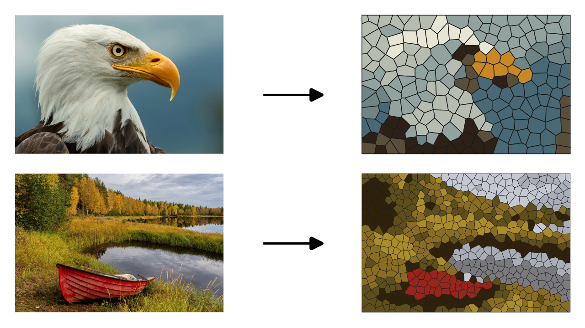

# Inkscape Vector Stained Glass

Convert a bitmap image into a vector "stained glass" pattern: the image is
color-quantized, subdivided into cells (Voronoi or Delaunay triangles), and each
cell is filled with its dominant palette color, with dark strokes between cells.

## Features

- Two cell shapes:
  - `voronoi` — organic polygonal cells from Poisson-disk / edge-weighted seeds
  - `triangles` — Delaunay-based triangular cells
- Color quantization via PIL (LibImageQuant)
- Optional edge-aware seed placement
- Pure numpy Delaunay (Bowyer-Watson), no scipy dependency
- Output is grouped paths, transform of the source image preserved

## Requirements

- Inkscape 1.x
- Python 3 with `numpy` and `Pillow`

## Install

1. Copy all files into your Inkscape extensions directory:
   - Linux: `~/.config/inkscape/extensions/`
   - macOS: `~/Library/Application Support/org.inkscape.Inkscape/config/inkscape/extensions/`
   - Windows: `%APPDATA%\inkscape\extensions\`
2. Restart Inkscape.

## Usage

1. Select a bitmap image in your document.
2. Go to **Extensions → Generate from Path → Vector Stained Glass**.
3. Adjust the options (see below) and apply.

The result is added as a group named `Vector Stained Glass`.

## Options

| Option            | Type    | Default    | Description                                                        |
| ----------------- | ------- | ---------- | ------------------------------------------------------------------ |
| `cell_shape`      | choice  | `voronoi`  | Cell shape: `voronoi` (organic polygons) or `triangles` (Delaunay).|
| `n_colors`        | int     | `12`       | Palette size for color quantization.                               |
| `n_seeds`         | int     | `600`      | Number of cells (seeds / target triangles).                        |
| `stroke_width`    | float   | `2.0`      | Outline stroke width between cells.                                |
| `seed_from_edges` | bool    | `False`    | Bias seed placement toward image edges (Voronoi only).             |
| `random_seed`     | int     | `42`       | RNG seed for reproducible results.                                 |
| `max_dim`         | int     | `600`      | Max dimension of the downscaled copy used for processing.          |

## License

MIT
